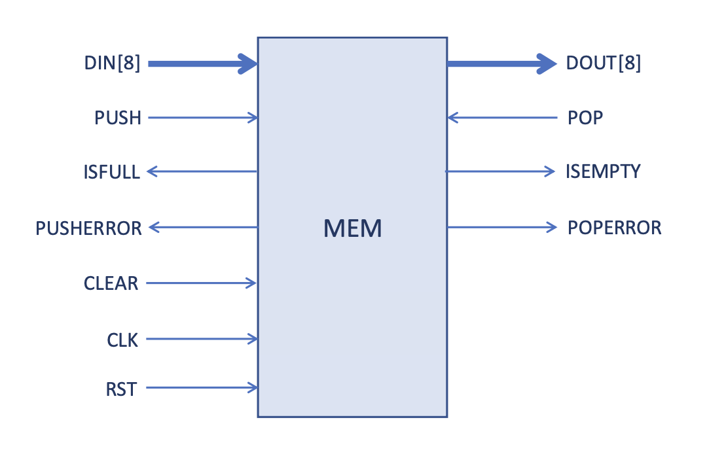
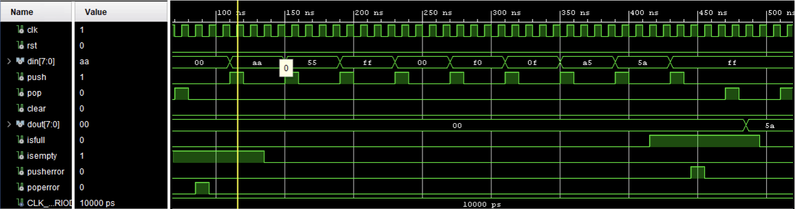

# Stack memory
This module was designed in Xilinx Vivado using VHDL.

To run the module, open the *stack_memory_jafari.xpr* file with Vivado, and then run a *Post Implementation Timing Simulation* to perform a **Post&Place Route** type of simulation.  

To browse the source code from GitHub navigate to *stack_memory_jafari.srcs/sources_1/new/* and to *stack_memory_jafari.srcs/sim_1/new/*

The module consists in a memory where we can **PUSH** and from which we can **POP** data from.  
Each stored memory word is 8 bits long. The module diagram is shown below: 

  

## Input Signals

+ DIN [8 bit]: 8-bit input word for inserting data into a memory row.

+ PUSH [1 bit]: Used together with DIN to push data into the stack.

+ CLEAR [1 bit]: Used to clear the memory and completely flush the stack in a single cycle (to improve performance, only the counter is reset to zero; the memory cells remain unchanged but are made available to be overwritten).

+ CLK [1 bit]: The clock that coordinates the timing of each operation.

+ RST [1 bit]: Used to completely reset the memory, restoring everything to its initial state.

+ POP [1 bit]: Used to pop (release) an element from the stack; its assertion triggers the output of the word contained in the last element of the stack through the DOUT signal.

## Output Signals

+ DOUT [8 bit]: 8-bit output word for reading the data contained in the last element of the stack. It is populated following the assertion of the POP input signal, only if the stack is not empty.

+ PUSHERROR [1 bit]: Asserted when attempting to insert a new element into the stack via PUSH while the stack is full (i.e., when ISFULL is asserted).

+ POPERROR [1 bit]: Asserted when attempting to free a slot from the stack via POP while it is empty (i.e., when ISEMPTY is asserted).

+ ISFULL [1 bit]: Automatically asserted when the stack is completely full.  

One possible set of signal behaviour is described in the image down below:  

  

## Project strengths
+ Reuse of components maximized across all the project with **generic** and **generate** constructs.

+ No inferred arithmetic or relational operators. It means that expressions like "Y <= A + B" via *std_logic_vector* variables are nowhere to be found in the project. All arithmetic operators are explicitly instantiated (or structurally designed).

+ The system has registers in all main input and output paths.

+ The optimal clock frequency is determined via simulation; the critical path is stressed to estimate the minimum clock period.